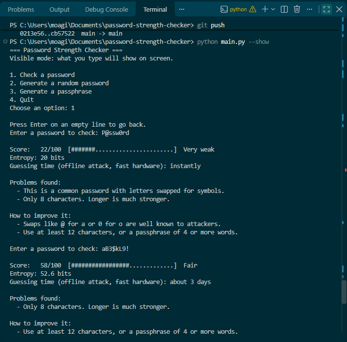

# Password Strength Checker

A Python command-line tool that scores how strong a password is, explains what is wrong with it, and generates secure random passwords and passphrases.



## Features

- **Strength score** from 0 to 100, with a rating from Very weak to Very strong
- **Weakness detection**, explained in plain English with suggestions:
  - common passwords, including a sample list of 54 and variations like `Password99!`
  - symbol swaps such as `P@ssw0rd`
  - keyboard and alphabet runs such as `qwer`, `4321` or `abcd`
  - repeated characters such as `aaa`
  - a year added to the end, such as `Summer2024`
  - passwords shorter than 12 characters
- **Guessing-time estimate** for an offline attack
- **Secure generator** for random passwords (8 to 64 characters, always with upper case, lower case, a number and a symbol) and word-based passphrases
- **36 automated tests**
- Uses only the Python standard library, with nothing to install

## How the score works

1. The password's **character pool** is worked out (lower case, upper case, digits, symbols), and its strength in bits is estimated as `length x log2(pool size)`.
2. Bits are **subtracted** for known weaknesses. A common password is capped at 12 bits, a symbol-swapped one at 20 bits, and sequences, repeats and a trailing year each cost further bits.
3. The result is converted to a **0 to 100 score** (90 bits counts as a full score).
4. The guessing time assumes **10 billion guesses per second**, which is an attacker with fast hardware and a weak hash.

Generated passwords and passphrases use Python's `secrets` module, which draws from the operating system's secure random source. The `random` module is predictable and unsuitable for this.

## Privacy

Everything runs on your own computer. Nothing is saved, logged or sent anywhere. By default what you type is hidden with `getpass`.

## How to run

Requires Python 3.8 or newer.

```
git clone https://github.com/Agi07/password-strength-checker.git
cd password-strength-checker
python main.py
```

Add `--show` to make typed passwords visible (useful for demos):

```
python main.py --show
```

## Run the tests

```
python -m unittest -v
```

## Project structure

```
checker.py              analysis, scoring and weakness detection
generator.py            secure password and passphrase generation
main.py                 command-line menu
test_password_tools.py  automated tests
```

## Limitations

This is a learning project. For real use, a mature tool such as zxcvbn is more accurate.

- **Passphrases are rated too generously.** The checker treats text as random characters and does not know about words, so a phrase made of a few dictionary words can score higher than it deserves. The generator reports the real randomness for the passphrases it makes.
- **The common-password list is small** (54 entries). Real tools check millions of leaked passwords.
- **The passphrase word list has 256 words** (8 bits per word). Standard Diceware lists have 7,776 words (about 12.9 bits per word), so six words from a Diceware list are much stronger than six from this one.
- **The guessing time is an estimate.** It assumes a fast offline attack. Online login attempts, slow hashing and rate limits make real attacks much harder.
- **It checks only what it is programmed to find.** A password can pass every check and still be weak, for example one based on personal details.
- **Never type a password you actually use** into any tool you do not fully trust.

## What I learned

How password entropy is estimated and why length matters most, why attackers try patterns and common words first, why `secrets` must be used instead of `random` for security, and how to be honest about what a tool can and cannot do.

Built by Moagi Makhudu, BSc Information Technology student.